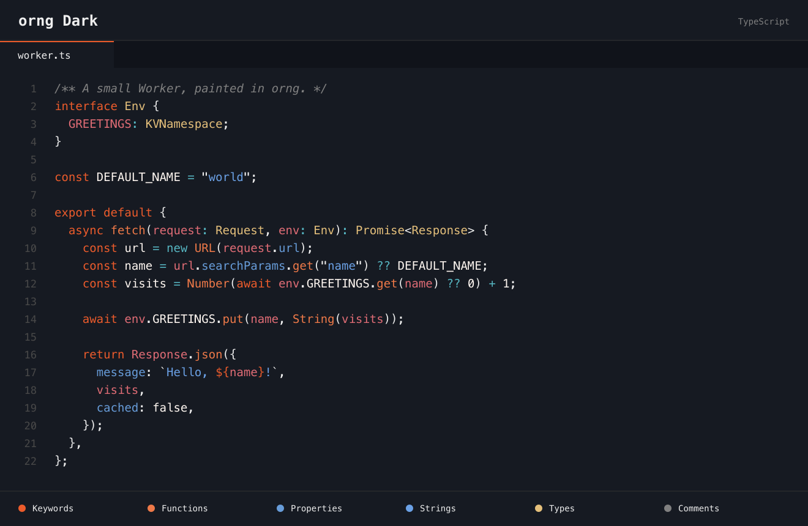
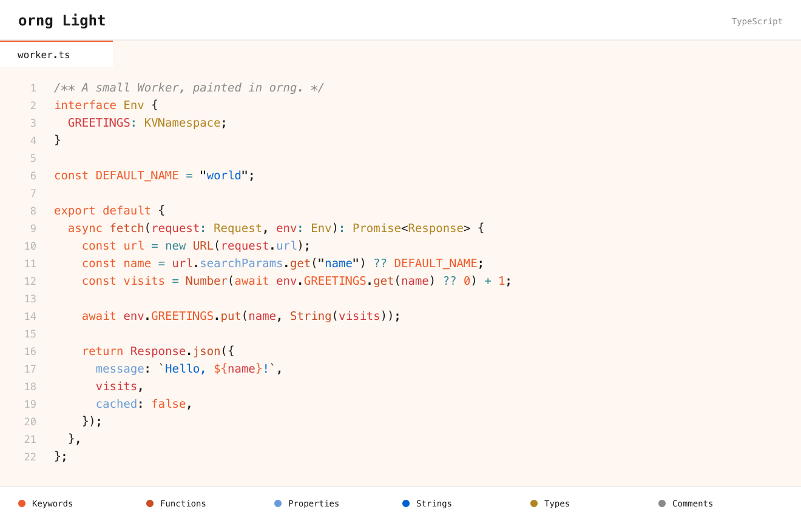

# orng for VS Code

The Cloudflare palette, in your editor. A VS Code recreation of [orng for Zed](https://github.com/elithrar/orng-zed), with dark and light themes inspired by [workers.dev](https://workers.dev/).

[](https://marketplace.visualstudio.com/items?itemName=kafwe.orng-vscode)
[](LICENSE)

Orange keywords. Blue strings. Gold types. Both themes keep the Zed theme's character, italic comments, and neutral brackets, with stronger line numbers, clearer light-theme syntax, and readable diff highlights for VS Code.

## orng Dark

Deep charcoal surfaces with warm orange accents.



## orng Light

A warm cream editor with white tabs and title bar.



*Previews are rendered from the theme files. Appearance in VS Code can vary with your font and language extensions.*

## Get started

Requires **VS Code 1.85 or later**.

1. [Install orng from the Marketplace](https://marketplace.visualstudio.com/items?itemName=kafwe.orng-vscode).
2. Open the Command Palette (`Cmd+Shift+P` on macOS / `Ctrl+Shift+P` on Windows and Linux) and run **Preferences: Color Theme**.
3. Choose **orng Dark** or **orng Light**.

To switch themes later, use `Cmd+K Cmd+T` on macOS or `Ctrl+K Ctrl+T` on Windows and Linux, pressing each shortcut in sequence.

<details>
<summary>Choose a theme in settings.json</summary>

Add this setting to your existing VS Code settings:

```json
{
  "workbench.colorTheme": "orng Dark"
}
```

Use `"orng Light"` for light mode.

</details>

## Why I made this

I loved using [orng in Zed](https://github.com/elithrar/orng-zed), but needed VS Code at work for Copilot and the skills and tools in its ecosystem. So I recreated the theme for VS Code to keep the look I liked in the editor I needed.

## Feedback

Found a color that looks out of place? [Open an issue](https://github.com/kafwe/orng/issues) with the theme name, language, a small code sample, and a screenshot.

## Contributing

With Node.js installed, run:

```sh
npm run build
npm test
```

Make changes in [the conversion script](scripts/build-themes.mjs), then rebuild. The JSON files in `themes/` are generated; `npm test` checks for unmapped syntax categories and differences from the generated output.

To preview changes:

1. Open this repository in VS Code.
2. Select **Run Extension** in Run and Debug and press `F5`.
3. Choose an orng theme in the new window and open the [TypeScript](test/sample.tsx), [CSS](test/sample.css), or [Markdown](test/sample.md) sample.

Run `npm run package` to create a VSIX, then use **Extensions: Install from VSIX…** to install it locally.

## Credits and license

Original [orng Zed theme](https://github.com/elithrar/orng-zed) by Matt Silverlock. Upstream copyright © 2025 Cloudflare, Inc. Licensed under [Apache-2.0](LICENSE).
